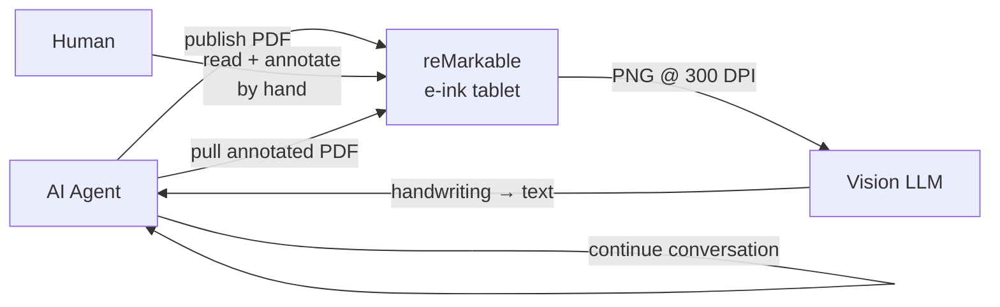

I have an AI agent that helps me think.

It produces research synthesis, architecture documents, plans. The kind of structured output that demands careful reading. Not skimming. Not scanning. Reading with a pen in hand, circling the important parts, crossing out the wrong ones, writing in the margins.

So I built a round-trip.

## The Workflow



1. **The agent produces an artifact** — a markdown document, rendered to PDF with mermaid diagrams, tables, e-ink-optimized typography (14pt serif, code that wraps instead of clipping).
2. **I say "push this to my reMarkable"** — the agent runs `ormb publish`, uploads the PDF to reMarkable Cloud via rmapi, which syncs to my Paper Pro tablet.
3. **I read on e-ink, annotate by hand** — no notifications, no tabs, no Slack. Just paper-feel pen on a distraction-free screen. I circle what matters. I cross out what doesn't. I write in the margins.
4. **I say "I'm done"** — the agent runs `ormb pull`, downloads the annotated PDF from reMarkable Cloud, renders every page to a 300 DPI PNG, sends each image to a vision LLM (GLM-4.5V via OpenRouter), and gets back structured text of my handwritten notes.
5. **The conversation continues** — the agent now has my feedback as text. It responds to the annotations, adjusts the design, iterates. The loop closes.

## Where Two Worlds Meet

The interesting thing isn't the individual pieces. AI agents produce documents. reMarkable tablets display them. Vision LLMs transcribe handwriting. Each of these is unremarkable on its own.

What's remarkable (pun intended) is the meeting point.

On one side: the most advanced capabilities in software. Agent orchestration that can produce a 4,000-word architecture document with embedded mermaid diagrams in seconds. Vision models that can read cursive handwriting from a 300 DPI photograph of an e-ink screen.

On the other side: the oldest technology humans have for thinking. Pen and paper. Marking up a document the way scholars have marked up manuscripts for a thousand years, circling, crossing out, writing between the lines.

The round-trip makes these two worlds talk to each other. The agent produces, the human annotates, the agent reads the handwriting back. The technology disappears into the background. What's left is a person thinking on paper and a machine that can read it.

## The Original Topology

The [reMarkable Roundtrip](https://github.com/vevmesteren/remarkable-roundtrip) project started here, as a Hermes Agent skill that published documents to the reMarkable and pulled handwriting back. No Obsidian, no plugin, no GUI. Just the agent, the CLI, and the tablet.

Then I extracted it into an open-source Python package and built an Obsidian plugin on top, because most people who use reMarkable tablets also use Obsidian, and they want a button in their vault, not a terminal command. [That story is told elsewhere](/blog/remarkable-roundtrip/).

But the agent topology, what I now call **T-AGENT**, is the original. It's the one I use every day. And with [release 0.2.0](https://github.com/vevmesteren/remarkable-roundtrip/releases/tag/0.2.0), it's first-class in the README, with its own topology entry alongside the Obsidian plugin topologies.

## The Capability Brief

Here's what you paste into your AI harness (Hermes, Claude, Cursor, whatever agent can run shell commands) to install and operationalize the round-trip. No Obsidian required.

```
# reMarkable Roundtrip — Agent Capability

## Setup (one-time)

Install the CLI:

  git clone https://github.com/vevmesteren/remarkable-roundtrip.git
  cd remarkable-roundtrip
  python3 -m venv .venv && source .venv/bin/activate
  pip install -e .
  ormb setup --rmapi       # downloads rmapi for your platform
  ormb setup               # installs Chromium for PDF rendering
  ormb pair                # pair with reMarkable (get a code at my.remarkable.com/connect)

For pull (annotation transcription), set an OpenRouter API key:
  ormb config set-key      # interactive — prompts for the key, not stored in shell history

## Round-trip protocol

When I ask you to push something to my reMarkable:
  - Render the document and run: ormb publish <path-to-file.md>
  - Use absolute paths if the file isn't under a configured vault path

When I tell you I'm done annotating (I've marked it up on my reMarkable):
  - Run: ormb pull <page-name> --md <path-to-source.md>
  - The page name is the filename stem (e.g. "c4-system-landscape")
  - Read my transcribed annotations and incorporate them into our conversation
  - Continue our work based on my feedback

## What this gives us

  - I read your output on e-ink paper — no notifications, no tabs, no Slack
  - I annotate by hand — circling, crossing out, writing in the margins
  - You read my handwriting back as text and we continue
  - The technology disappears; what's left is a person thinking on paper
    and a machine that can read it.
```

That's it. Four install commands, three protocol rules, and you're round-tripping between an AI agent and an e-ink tablet.

## Why This Matters

I work at a bank. I lead a tech factory. I spend my days in meetings, in documents, in architecture reviews. The tools that demand my sharpest thinking are the ones that produce the densest output: strategy documents, system designs, research synthesis.

I don't want to read those on a screen with 47 tabs open and Slack buzzing. I want to read them the way I read everything that matters: on paper, with a pen, in the quiet.

The round-trip gives me that. The agent produces. I read on e-ink. The agent reads my handwriting back. And we continue.

It's not the most technically impressive thing I've built. It might be the most useful.

---

The code is at [github.com/vevmesteren/remarkable-roundtrip](https://github.com/vevmesteren/remarkable-roundtrip). MIT licensed. The [0.2.0 release](https://github.com/vevmesteren/remarkable-roundtrip/releases/tag/0.2.0) adds T-AGENT as the original topology with the capability brief above. If you use an AI agent and a reMarkable tablet, this gives you the conversation between them.
