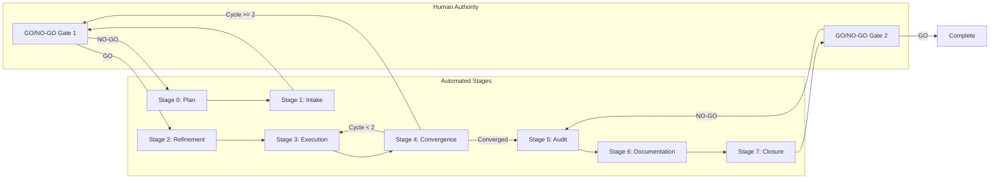
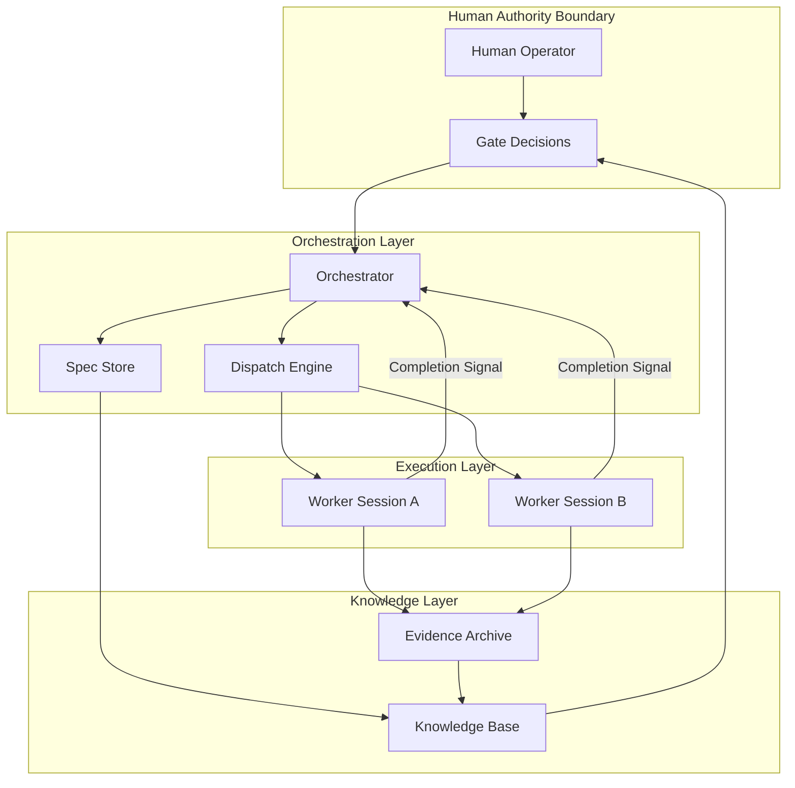

## The Premise

The model is the easy part.

I've spent the last year building an autonomous agent platform that ships real software—not demos, not proofs of concept, but production systems that run in production environments and handle real traffic. The surprising lesson isn't about model capability. It's about everything *around* the model.

The delivery system—the scaffolding that turns generated code into shipped software—is the hard part. The model can write code. It can write good code. But turning that code into a commit that passes CI, gets reviewed by eyes that weren't involved in writing it, and lands in a production branch without breaking the build? That requires structure the model can't provide for itself.

This essay breaks down one value stream: software delivery, stage by stage. It's a record of my personal learning journey—what I've learned building and running this system, and where the gaps still are. The goal isn't to sell you on AI-assisted delivery. It's to share the honest picture of what it has taken to build it—and where I haven't finished building it yet.

---

## The Migration: A Learning Journey

I started on Claude Code. I built the first iteration of this delivery system there — waves, definition of ready, definition of done, test cases, test plans. The whole nine yards. GitHub issues tracked every agent action. Each worker left a trace. The flow was auditable. Claude Code didn't lack structure; it had plenty.

What it didn't have was model variance across vendors. Claude Code varies between Anthropic model families — faster models for mechanical work, larger models for reasoning. But you're locked to one vendor's model family, one cost curve, one set of trade-offs. There's no routing a task to a model from a different lab because it's better at that specific thing, or cheaper for that specific volume. The harness decides, and the decision space is single-vendor.

So I moved. Hermes for orchestration and scheduling. OpenCode for the worker layer. OpenRouter to route each task to the right model. The delivery system I'd built on Claude Code migrated cleanly: the gates, the waves, the convergence discipline, the producer≠verifier split. What changed was the model layer — because now I could choose, per story, per role, which model to use. Frontier reasoning where it matters. Efficient models where it doesn't.

But the real reason wasn't cost. It was understanding. When you rent a managed harness, you get output but not architecture. You don't see how decisions are made. You can't redesign the parts that don't fit your context. Moving to Hermes and OpenCode meant I had to understand every layer — how dispatch works, how gates fire, how convergence is enforced, how the model posture table routes tasks. Not because I wanted to build a harness (everyone's building harnesses). Because I wanted to understand the system I was relying on.

This is a learning journey, not a platform endorsement. The delivery system is what I own and understand. The model is what I route.

---

## The Wave Model

Work arrives in batches I call waves. Each wave is a deliberately sized unit that flows through the pipeline as a cohort.

The sizing is deliberate. A single giant task carries too much risk—if something goes wrong halfway through, you've burned context, burned tokens, and have half-finished work scattered across branches. One ticket at a time is too slow—the overhead of dispatch, context-building, and convergence dominates the actual work. Waves hit a middle ground: enough scope to amortize the overhead, small enough that failure doesn't cascade.

Each wave has three properties:

1. **Fixed scope at entry.** The wave's contents are locked when it passes the intake gate. Mid-flight scope changes create the same chaos in AI-assisted delivery that they create in human delivery—worse, actually, because the agent doesn't have the social awareness to push back on scope creep.

2. **Human gates at entry and exit.** The AI prepares the work. A human decides whether it proceeds. This isn't a formality.

3. **Convergence discipline.** Work within the wave must converge within bounded cycles. If it doesn't converge, it escalates—it doesn't loop forever.

---

## The Two Gates

Stage 1 (intake) and Stage 8 (closure) both have GO/NO-GO decisions.

At intake, the question is: "Is this work ready to execute?" Not "is the ticket filled out" but "does the specification meet structural criteria that give the downstream execution a fighting chance?"

At closure, the question is: "Did this work deliver what it promised?" Not "did the PR merge" but "can we demonstrate that the acceptance criteria in the specification were satisfied?"

Both gates require a human decision. The system is designed to *pause* at these gates, not blow through them. The AI prepares the evidence—the specification, the test results, the coverage reports, the review approvals—but the human makes the call.

This design choice is deliberate. The temptation is to let the AI handle everything and only escalate exceptions. But exceptions in software delivery often look normal until they explode. A human at the gates catches the ones that slip through pattern matching.

---

## Convergence Discipline

Code changes and reviews converge within a maximum of two rework cycles—reduced from our earlier limit of three.

Cycle 0: The change is authored. Cycle 1: Review feedback, revision. Cycle 2: Final review feedback, final revision. If it doesn't converge by cycle 2, it escalates to the human authority—it doesn't loop forever.

This is a timeout mechanism for AI-assisted work. The model doesn't know when it's spinning. It will happily rewrite the same function twelve times if the reviewer keeps finding issues. The convergence limit is external discipline that says: after two rounds, something structural is wrong. Either the specification was unclear, the implementation approach was flawed, or the review criteria are inconsistent. Any of those require human judgment, not more cycles.

The number two isn't magic. It's calibrated from observation after dropping the cap from three: most legitimate changes converge in one cycle. Changes that need two are catching real issues. Changes that used to drag into a third cycle were almost always symptomatic of deeper problems.

---

## Producer ≠ Verifier

The agent that writes the code is structurally not the agent that reviews it.

This isn't a policy document that says "please use a different reviewer." It's a structural invariant enforced at dispatch time. The producing session and the verifying session are different—different context, different session ID, different model if available. The system won't dispatch a review to the same session that produced the work.

Why does this matter? The same failure mode that afflicts human code review—the author's mental model contaminating the review—is worse with AI. The model that wrote the code has the same context, the same assumptions, the same blind spots. Asking it to review its own work is asking it to find mistakes in reasoning it already accepted.

This connects to a principle I've written about elsewhere: the boundary between producing knowledge and validating knowledge must be structural, not procedural. See [Knowledge Architecture for Autonomous Agent Platforms](/blog/knowledge-architecture-autonomous-agents/) for the deeper treatment. The same hash-chain principle that keeps knowledge integrity applies here: the evidence of review must be separable from the evidence of production.

---

## The Checkpoint Model

Work flows through named checkpoints:

Each checkpoint has entry criteria. Plan requires a problem statement. Intake requires a structured specification. Refinement requires the specification to pass readiness checks. And so on.

The point isn't bureaucracy. It's that AI-assisted delivery needs *more* structure than human delivery, not less. A human developer has the judgment to skip steps responsibly—to eyeball a change and know it doesn't need a full test suite run, to glance at a diff and know it doesn't need security review. The model doesn't have that judgment. Without external structure, it either over-processes everything or under-processes dangerously.

The checkpoints are the external structure. They encode the judgment the model lacks.

This is also where the documentation stage connects to the broader knowledge architecture. The artifacts produced at the documentation stage—the specs, the design decisions, the test evidence—feed into the cognitive memory layer described in [Knowledge Architecture for Autonomous Agent Platforms](/blog/knowledge-architecture-autonomous-agents/). The checkpoints aren't just delivery process; they're the ingestion point for organizational knowledge.

---

## Specification as Contract

Before the AI touches code, the work unit carries a specification.

Not a ticket with a title and acceptance criteria buried in a comment. A structured spec that lives inside the issue tracker itself—not in a separate tool, not in a specs/ folder that drifts from the code. The issue tracker is the container. The knowledge base is where the spec lives after delivery. There is no third place.

The specification follows conventions adapted from [OpenSpec](https://openspec.dev/):

**MUST/SHALL language.** Requirements are normative, not aspirational. "The system MUST reject unsigned commits" is different from "we should probably validate signatures." The first is testable. The second is a suggestion.

**Scenarios as testable acceptance criteria.** Every requirement traces to at least one scenario with GIVEN/WHEN/THEN structure. If you can't write a scenario for it, it's not a requirement—it's a wish. The scenario is the contract: when the scenario passes, the requirement is satisfied.

**The spec is alive.** It evolves with the implementation. When the design shifts mid-execution (and it does), the spec shifts. This isn't scope creep—it's honest acknowledgment that the spec at intake was a hypothesis about what the work needed. The spec at closure is what the work actually delivered.

**Delta tracking.** Requirements are grouped by change type: ADDED, MODIFIED, REMOVED. Each MODIFIED requirement references the baseline it changes. This makes spec review tractable—you're not reading the whole spec, you're reading what changed.

**Definition of Ready.** A work unit is not ready to enter execution until its specification meets structural criteria: it opens with a jargon-free problem statement, the specification section is present, at least one requirement uses normative language (MUST or SHALL), and at least one requirement has a testable scenario. A specification where every requirement is optional—or where the problem statement hides behind internal shorthand—doesn't meet this bar.

The spec is the only thing that travels from the conversation that defined the work to the session that executes it. If it's vague, the output is vague. If it's precise, the output has a fighting chance.

This connects back to the knowledge architecture: specs aren't just delivery artifacts, they're the knowledge base's input format. The structure that makes specs machine-readable for execution also makes them machine-indexable for retrieval.

---

## Architectural View

The trust boundaries matter:

- **Human Authority Boundary**: Gate decisions require human approval. The system prepares evidence; humans decide.
- **Orchestration Layer**: Automated but transparent. The orchestrator dispatches work and collects results but doesn't make GO/NO-GO calls.
- **Execution Layer**: Workers are isolated from each other. Producer and verifier sessions never share context.
- **Knowledge Layer**: Receives artifacts from all layers. The knowledge base is downstream of execution, not upstream—it doesn't drive execution, it records what execution produced.

---

## What Doesn't Work Yet

The honest part. Five gaps, each framed as: what's broken, what I know, and what needs to happen next.

**Gap 1: Gate enforcement is convention-based.** The GO/NO-GO gates are enforced by process discipline, not by the system mechanically verifying that evidence was reviewed before the gate opened. A human could rubber-stamp without reading. I know the shape of the answer—evidence must be durable (content-addressed), canonically labelled, and verifiable—but I haven't done the full design. This needs a formal architecture review before I'd trust it in production.

**Gap 2: Team definitions aren't standardized.** Not every work unit declares "who develops, who reviews, who tests" at creation time. Some do, some don't. The fix is a mandatory field at creation—not research, just a process change I need to implement.

**Gap 3: Phase closure isn't automated.** The 8-step closure sequence is documented but performed manually. Steps can be skipped without the system noticing. I have the design (the 8 steps are defined), but the capability to mechanically walk them and refuse completion until each is verified doesn't exist yet. This needs architecture review before I'd trust it in production.

**Gap 4: Environment bridging is incomplete.** Worker agents don't receive all the environment context they need. The dispatch payload can miss variables. The fix is an explicit allowlist in the dispatch payload—I know exactly what to build, I just haven't done it.

**Gap 5: Route emission isn't integrated.** While the system can determine touched files via `git diff`, worker agents don't automatically emit a route manifest upon completion. The orchestrator lacks an automated audit trail of the blast radius, meaning this critical context isn't fed back into the orchestration loop. The fix is integrating that `git diff` output directly into the harness process as a route manifest in the completion signal. Same as gap 4—I know the shape, I just haven't built it.

**The pattern across all five:** Gaps 4 and 5 are engineering work—I know the fix, I just haven't done it. Gap 2 is a process change. Gaps 1 and 3 need design work before implementation—not because I don't know what to do, but because the solution needs to survive an adversarial review before I'd trust it in production.

The discipline isn't having no gaps. It's knowing which gaps need research, which need design, and which just need a commit.

---

## The Meta-Point

The gaps aren't embarrassments—they're the honest state of a system being built in the open.

Knowing the gap, having a hypothesis about the fix, and being willing to run a formal architecture review before building the solution—that's the discipline. The temptation with AI-assisted delivery is to let the model paper over structural weaknesses by being "good enough." A model that's good enough can ship code that works most of the time. Most of the time is not good enough when the failures are silent and the blast radius is production.

The countermeasure is to name what's broken, state what I think will fix it, and design the fix before I build it.

The discipline isn't in the AI. It's in the scaffolding—the specs, the gates, the convergence limits, and the honest accounting of what doesn't work yet.
