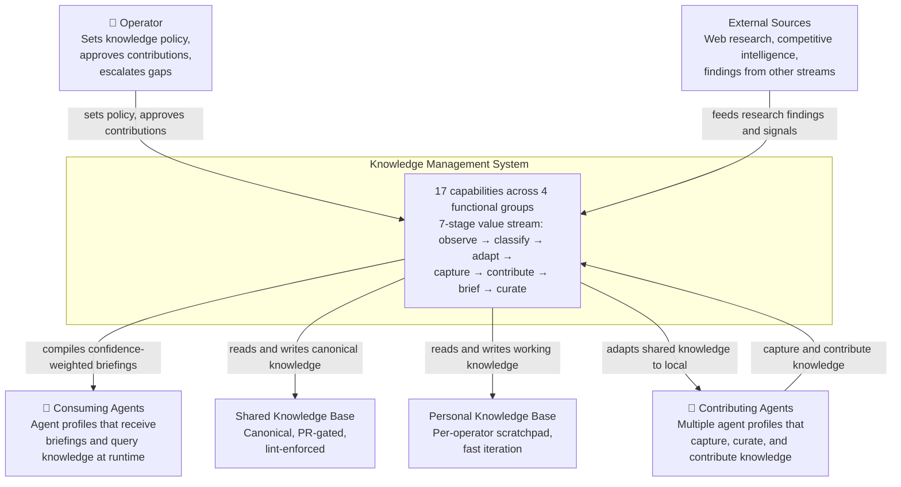
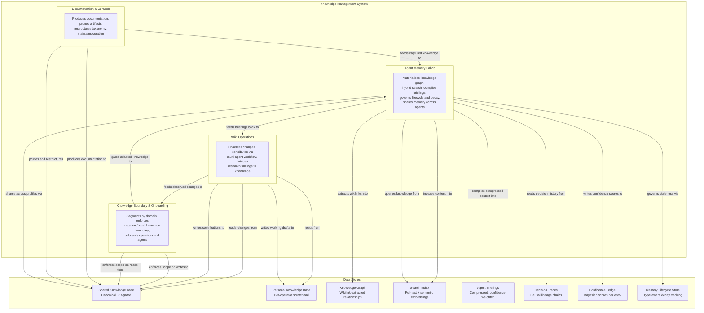
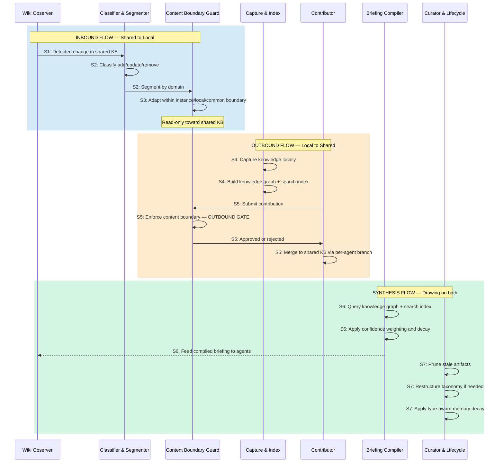
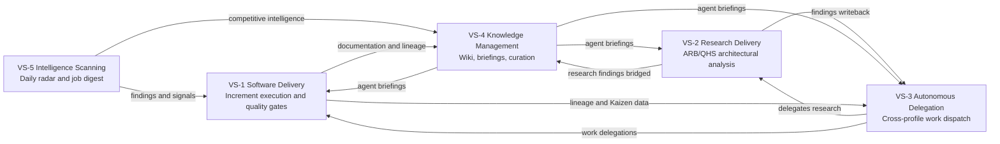

I run an autonomous agent platform. Multiple AI agent profiles — each with its own context, tools, and personality — build software, conduct research, and manage projects without me hovering over their shoulders. They work in parallel, delegate to each other, and run on schedules. Some have been running for months.

The hard part isn't making them work. The hard part is making them remember.

Not remember in the sense of a longer context window. Remember in the sense of: when an agent picks up a new task, it should know what was decided last week, what architecture we chose, what we rejected and why, what's stale, and what's still trustworthy. It should walk into the room briefed — not amnesiac, not hallucinating, not confidently wrong.

This is a knowledge management problem. But not the kind solved by a wiki and a hope. It requires a system.

## The Problem: Three Failure Modes

Autonomous agent platforms that don't manage knowledge fail in three predictable ways.

**Knowledge rot.** Agents produce documentation, architecture decisions, research findings, and process artifacts continuously. Without active curation — pruning stale entries, restructuring taxonomy, retiring obsolete concepts — the knowledge base becomes a landfill. Agents retrieve outdated information and act on it. The system gets worse the more it produces.

**Context starvation.** An agent starting a new task faces a blank context window. It could search the knowledge base, but raw search returns everything — including the noise. Without pre-digested, confidence-weighted briefings, the agent either drowns in context or operates without it. Both produce bad work. The cost isn't just quality; it's tokens. Uncompressed context is expensive, and most of it is irrelevant to the task at hand.

**Boundary erosion.** Knowledge has tiers. Some is canonical and shared — architecture standards, domain models, governance decisions. Some is personal and exploratory — research drafts, scratchpad notes, half-formed ideas. Without enforced boundaries, personal notes leak into the canonical knowledge base and pollute it. Or canonical knowledge never reaches the agents that need it. The system needs a membrane, not a wall — permeable in one direction, gated in the other.

These three failure modes compound. Rot makes starvation worse (more noise to filter). Starvation makes agents produce lower-quality work, accelerating rot. Boundary erosion ensures that the wrong knowledge reaches the wrong agent at the wrong time.

The question isn't whether to manage knowledge. It's how to build a system that manages its own knowledge — capture, curate, and surface — while staying honest about what it knows and what it doesn't.

## The Conceptual Model

The Knowledge Management domain decomposes into four functional groups and one seven-stage value stream. The groups describe *what* the system does; the value stream describes *how knowledge flows through it*.

### Four Functional Groups

**Documentation & Curation** produces, prunes, and restructures knowledge artifacts. This is the group that writes documentation, curates existing entries, and restructures the taxonomy when the domain evolves. It's the editorial function.

**Wiki Operations** observes the shared knowledge base, contributes new knowledge through a multi-agent workflow, and bridges research findings into durable knowledge. This is the ingestion and publication function.

**Knowledge Boundary & Onboarding** segments knowledge by domain, enforces the content boundary between tiers, and onboards new operators and agents. This is the membrane function — it decides what goes where.

**Agent Memory Fabric** materializes the knowledge graph, provides hybrid search, compiles agent briefings, governs memory lifecycle and decay, and shares memory across agents. This is the retrieval and synthesis function — it turns stored knowledge into actionable context.

### Why a Value Stream, Not a Pipeline

A pipeline moves material in one direction: input → process → output. Knowledge doesn't work that way. Knowledge flows in two directions:

- **Inbound**: changes to the shared knowledge base propagate to local agent knowledge (shared → local)
- **Outbound**: agents capture new knowledge locally, then contribute it back to the shared base (local → shared)

A value stream accommodates both directions within a single, coherent flow. Each stage has a clear input and output, but the stream as a whole is bidirectional. The boundary enforcement sits at the outbound gate — the moment an agent tries to promote local knowledge to shared — not at inbound. Inbound is read-only toward the shared base; outbound is gated.

### Two Knowledge Tiers

The system operates on two tiers:

- **Shared knowledge** — canonical, PR-gated, lint-enforced. This is the system of record. Changes go through review. Every agent reads from it.
- **Personal knowledge** — per-operator scratchpad. Fast iteration, no gates. This is where research drafts, working notes, and half-formed ideas live until they're ready for promotion.

The boundary between them is the most critical architectural decision in the domain. Get it wrong and either the shared base degrades (too much noise) or agents starve (too little signal).

## C4 Level 1 — System Context

The Knowledge Management system sits between the humans who set policy and the agents who both contribute to and consume from it.

The operator is the trust anchor — a single human who sets policy, approves contributions, and escalates gaps. Contributing agents write knowledge; consuming agents read briefings. In practice, most agents do both. The shared knowledge base is external to the system (it's a git repository with its own governance), and the system reads from and writes to it through the value stream.

External sources — web research, competitive intelligence, findings from other value streams — flow in continuously. The system's job is to ingest, classify, and route them to the right tier.

## C4 Level 2 — Container View

Inside the Knowledge Management system, four capability containers operate on eight data stores. Each container owns a cluster of capabilities; each data store has a specific role in the knowledge lifecycle.

The data stores map to the knowledge lifecycle:

- **Shared Knowledge Base** is the canonical store. PR-gated, lint-enforced. All agents read from it; contributions go through the boundary.
- **Personal Knowledge Base** is the scratchpad. Fast, no gates. Where drafts live before promotion.
- **Knowledge Graph** extracts relationships from wikilinks. It's the structural index — not just what knowledge exists, but how it connects.
- **Search Index** is the retrieval index. Full-text and semantic embeddings. This is what agents query at runtime.
- **Agent Briefings** are the output of synthesis — pre-digested, compressed context ready for injection into an agent's working context.
- **Decision Traces** capture causal lineage: what was decided, why, and what followed. The system has 24,825 traces across 603 sessions.
- **Confidence Ledger** holds Bayesian confidence scores per knowledge entry. 9,018 entries scored. This is what separates "well-established" from "speculative."
- **Memory Lifecycle Store** tracks staleness and decay. Knowledge has a shelf life; this store enforces it.

## Data Structure

### The Three-Tier Content Boundary

Knowledge lives in three tiers, and the boundary between them is the architectural backbone of the entire domain.

**Instance** is per-agent. Private scratchpad. Fast, no gates. An agent working on a task writes notes here without asking permission. This is where thinking happens.

**Local** is per-profile. Shared within one agent profile but not across profiles. Internal working knowledge — research drafts, in-progress architecture decisions, pre-review analysis. The agent profile owns this tier.

**Common** is shared across all profiles. PR-gated, lint-enforced, canonical. This is the system of record. Changes go through review. Every agent reads from it. No agent writes to it directly.

The boundary enforcement is asymmetric. Inbound (shared → local) is read-only — agents can pull from common freely. Outbound (local → shared) is gated — promotion to common requires the contribution workflow (per-agent branches, lint, review). This asymmetry is deliberate: it's easy to read canonical knowledge, hard to pollute it.

### Taxonomy and Its Evolution

The knowledge base isn't flat. It's organized by domain — software architecture, research, governance, strategy, operations — with each domain having its own sub-structure. The taxonomy isn't static; it evolves as the domain matures.

Taxonomy evolution uses a split-vs-prune method. When a domain grows too large, it's split into sub-domains. When a domain shrinks or becomes irrelevant, it's pruned. The method is proven; the ongoing maintenance is not yet operationalized. This is one of the gaps I'll discuss later.

### Knowledge Graph

The knowledge graph is extracted from wikilinks — the cross-references between knowledge entries. It's materialized incrementally: when a new entry is added or a wikilink changes, the graph updates. The graph enables multi-hop traversal: "what architecture decisions reference this capability?" or "what research findings support this strategy?"

The graph is built, but it needs a production rebuild process to reach full maturity. Today it's structurally correct but not kept continuously fresh.

### Confidence Scoring

Every knowledge entry carries a Bayesian confidence score in the Confidence Ledger. The score reflects how much evidence supports the entry — how many agents have referenced it, how many decisions cite it, how recent it is, whether it's been challenged.

Confidence scoring is live and operational. 9,018 entries are scored. The scores feed directly into agent briefings: high-confidence knowledge gets priority placement; low-confidence knowledge is included with a caveat or excluded entirely. This is what prevents agents from treating a speculative research draft with the same weight as a ratified architecture decision.

## The Workflow: Seven Stages

The value stream has seven stages. The first three handle inbound flow (shared → local). The next two handle outbound flow (local → shared). The final two synthesize and govern.

### S1: Observe Wiki

A background observer watches the shared knowledge base for changes. When a new entry is added, an existing one is updated, or something is removed, the observer fires. This is the inbound trigger — the moment the system learns that canonical knowledge has shifted.

### S2: Classify & Segment

Changes are classified (add, update, remove, irrelevant) and segmented by domain. Two-level gating ensures that a change to the architecture domain doesn't flood the operations domain's local knowledge. This is where noise is filtered — most changes are irrelevant to most agents.

### S3: Adapt Local Knowledge

Classified changes are adapted to local context. An architecture decision in the shared base becomes a local working note for the agent profile that needs it. The content boundary is enforced here: the adaptation respects the instance/local/common distinction. An agent gets the knowledge it needs in the tier it belongs.

### S4: Capture & Index

When an agent produces new knowledge — a research finding, an architecture decision, a process document — it's captured locally. The knowledge graph is updated (new wikilinks, new relationships). The search index is updated (new content available for retrieval). This is the outbound starting point: knowledge exists locally and needs to flow to shared.

### S5: Contribute & Share

This is the outbound gate. A contribution is submitted through the boundary, which enforces the content boundary — does this knowledge belong in common, or should it stay local? If approved, it's merged to the shared knowledge base through a per-agent branch workflow. If rejected, it stays local. Cross-agent sharing also happens here: knowledge that's relevant to multiple profiles is routed through the shared store, not duplicated.

### S6: Brief Agents

The briefing compiler queries the knowledge graph and search index, applies confidence weighting and decay, and produces a compressed, pre-digested context for agents. This is where the 97.79% context reduction happens: raw knowledge base entries are synthesized into a compact briefing that an agent can inject into its working context. The briefing is confidence-weighted — high-confidence knowledge gets priority; low-confidence knowledge is flagged.

### S7: Curate & Govern Lifecycle

The curator prunes stale artifacts, restructures the taxonomy when domains evolve, and applies type-aware memory decay. Different knowledge types have different shelf lives: a strategy document might be valid for months; a research draft might be stale in weeks. The lifecycle store tracks this and enforces it.

## Integration with Delivery

Knowledge Management doesn't exist in isolation. It's one of five value streams in the platform, and it's the connective tissue that connects them all.

Every stream both contributes to and consumes from Knowledge Management:

- **Software Delivery (VS-1)** feeds documentation and lineage records into the knowledge base. When an increment is completed, its documentation is captured. When a decision is made, the lineage is recorded. In return, VS-1 agents receive briefings — pre-digested context about the architecture, the domain model, and prior decisions.

- **Research Delivery (VS-2)** bridges research findings into knowledge. When an architectural review or a strategic analysis completes, the findings are bridged — published to the knowledge base and routed to the requesting agent. In return, VS-2 agents receive briefings about prior research, so they don't re-litigate settled questions.

- **Autonomous Delegation (VS-3)** dispatches work across profiles. When a delegation completes, the outcome is reported and the knowledge is captured. In return, VS-3 agents receive briefings that include the state of the knowledge base — what's been decided, what's in progress, what's stale.

- **Intelligence Scanning (VS-5)** feeds competitive intelligence and research signals into both VS-1 (for action) and VS-4 (for knowledge capture).

KM is the only stream that every other stream reads from. It's also the only stream that every other stream writes to. That's what makes it connective tissue rather than a pipeline — it's bidirectional with everything.

## What Works, What Doesn't

I designed this system. I operate it daily. Here's an honest inventory.

### What's Live and Operational

**Knowledge capture and contribution** (C18, C23, C24) works. Agents produce documentation, contribute through the multi-agent workflow, and bridge research findings. The contribution pipeline — per-agent branches, lint enforcement, auto-merge — has been running for months.

**Curation and taxonomy restructuring** (C19, C21) works. I've restructured the taxonomy multiple times as the domain evolved. The split-vs-prune method is proven.

**Decision traces and confidence scoring** (C45, C46, C47) works. 24,825 traces across 603 sessions. 9,018 confidence-scored entries. The causal lineage is queryable and the confidence scores feed into briefings.

### What's Built but Dormant

**Wiki observation** (C22) is built but the observer cron is dead. It hasn't run since August. This means the inbound flow — shared → local adaptation — is broken. Agents don't automatically learn when the shared knowledge base changes. I manually pull updates when I notice them. This is a known gap and it's next on the fix list.

**Hybrid search and retrieval** (C49) is built but has no live rebuild process. The search index exists but isn't kept fresh. Tests are failing. Agents can query, but the results are incomplete.

**Agent briefings** (C51) is the most frustrating gap. The capability works — it produces 97.79% context reduction — but no agent consumes the briefings. Two briefings have ever been produced. The compression is proven; the consumption is not wired. This is the single biggest leverage point in the domain: if I wire briefings into agent dispatch, every agent gets pre-digested, confidence-weighted context for free.

**Memory lifecycle and decay** (C50) is built but all entries are stale. The decay process isn't running. Knowledge doesn't expire because nothing enforces expiration.

**Cross-agent memory sharing** (C52) is built but the shared store has zero entries. The capability exists; the population doesn't.

**Content boundary enforcement** (C42) is built but the enforcement chain has fail-open points. The boundary is more advisory than enforced. In practice, I rely on convention and review rather than automated gating.

### The Single-Operator Trust Model

This system runs with a single operator — me. I set policy, approve contributions, and escalate gaps. That works at this scale because I'm in the loop on every meaningful decision. The trust model is: the human is the final gate.

At enterprise scale, this breaks. A single operator can't review every contribution. The boundary enforcement can't be advisory — it has to be automated and non-bypassable. The confidence scoring needs to drive automated routing, not just briefing priority. The decay process needs to run continuously, not when I remember to trigger it.

### What I'd Do Differently

Three things, in order of regret:

1. **Wire briefings into dispatch from day one.** I built the briefing compiler (C51) late, after agents were already running without it. The result is months of agents operating without pre-digested context. The 97.79% compression was proven but never consumed. If I were starting over, briefings would be the first capability, not the last.

2. **Make the observer cron self-healing.** The wiki observer (C22) died silently and I didn't notice for weeks. A cron that can die without alerting is worse than no cron — it creates false confidence. I'd build heartbeat monitoring into every background process from the start.

3. **Enforce the boundary at the code level, not the convention level.** The content boundary (C42) is enforced by convention — agents are *supposed* to respect the instance/local/common distinction. In practice, the fail-open chain means knowledge leaks. At this scale, I catch it in review. At scale, I wouldn't. The boundary needs to be a hard gate, not a soft recommendation.

---

Knowledge management for autonomous agents isn't a wiki. It's a system with a domain model, a value stream, data stores, and honest gaps. The architecture works when it's honest about what it knows and what it doesn't — when confidence scores are real, when decay is enforced, and when briefings actually reach the agents that need them.

I'm not there yet. But the architecture is sound, the gaps are known, and the next step is clear: wire the briefings, fix the observer, and let the system start managing its own knowledge instead of waiting for me to do it.
