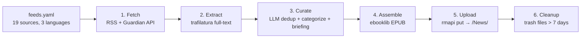

Every morning, I would open my laptop and check the news. The Guardian, BBC, CBC, Der Spiegel, Le Figaro — I'd bounce between sites across three languages, skim headlines, open tabs, and try to get a sense of what mattered before my coffee got cold. It was inconsistent, time-consuming, and the reading experience on a screen was worse than what I had on my desk: a reMarkable Paper Pro.

The reMarkable was paired and ready. It had no built-in news pipeline. So I built one.

## The Problem

Stated as a [GitHub epic](https://github.com/vevmesteren/remarkable-morning/issues/1):

> The operator manually checks multiple news sites across 3 languages (EN/DE/FR) every morning. This is time-consuming, inconsistent, and the reading experience on screens is inferior to e-ink.

The outcome I wanted was specific: a Python pipeline that runs at 05:30 EDT daily via systemd, fetches 19 news sources across English, German, and French, extracts full article text, runs a single LLM curation call for deduplication and categorization, assembles a reflowable EPUB, uploads it to `/News/` on the reMarkable via rmapi, and trashes files older than 7 days. Total cost per run: under five cents.

## Architecture: A Seven-Stage Pipeline

The design is deliberately straightforward — a linear pipeline where each stage has one job, logs its timing, and fails gracefully:

```
feeds.yaml → Fetch → Extract → Curate → EPUB → Upload → Cleanup
```



**Stage 1 — Fetch.** Two source types: RSS feeds via `feedparser` and the Guardian Content API via `httpx`. Each source is independent — one broken feed logs an error and gets skipped, not fatal to the whole pipeline. This matters because feeds break constantly.

**Stage 2 — Extract.** `trafilatura` does the heavy lifting: takes raw HTML and extracts the article body text, stripping navigation, ads, and boilerplate. This is where the first real-world problems showed up.

**Stage 3 — Curate.** A single LLM call to OpenRouter. The pipeline sends only article metadata — title, source, URL, language, first 200 words — never the full body text. The LLM deduplicates stories across sources, assigns categories, and writes a 3-5 sentence morning briefing. This is the intelligence layer: it's what turns 80-120 raw articles into 15-25 curated ones.

**Stage 4 — EPUB assembly.** `ebooklib` builds a reflowable EPUB with a cover page (title, date, briefing, source counts, table of contents by category), one chapter per article, and source URL footers. Reflowable is the key word — the reMarkable's e-ink display lets you adjust font size, and a fixed-layout PDF would defeat the purpose.

**Stage 5 — Upload.** `rmapi put` pushes the EPUB to `/News/` on the reMarkable cloud, which syncs to the tablet.

**Stage 6 — Cleanup.** Files older than 7 days are trashed via `rmapi rm`. No manual maintenance.

## The Stories: What Broke and How It Got Fixed

A pipeline that fetches 19 real-world news sources is a pipeline that will break in creative ways. Three issues stand out.

### The Anti-Scraping Ghost ([#3](https://github.com/vevmesteren/remarkable-morning/issues/3))

Sifted, a European fintech publication, uses JavaScript-based anti-scraping that renders a clean first sentence for SEO crawlers, then scrambles the rest of the article body with character substitution. `trafilatura` extracts the scrambled text faithfully — it's doing its job. The result reads like a cipher.

I added a gibberish detector that flags articles with unusual character distributions, but that just turned scrambled text into `[Article text unavailable]`. A reader seeing that in their morning digest loses trust in the whole pipeline. The fix wasn't better detection — it was removing the source. Sifted articles will never have readable body text without a headless browser, and a headless browser is too heavy for a daily pipeline that runs in seconds.

The gibberish detector stayed as a safety net for other sources. But the lesson was clear: **don't build detection for problems you can eliminate by removing the source.**

### The Video Player Impostor ([#12](https://github.com/vevmesteren/remarkable-morning/issues/12))

France 24 publishes video segments as RSS entries. These pages have no article text — just a video player. But `trafilatura` extracts the video player's error message: *"Une extension de votre navigateur semble bloquer le chargement du lecteur vidéo..."* — which reads as clean French and passes the gibberish detector because it IS clean text. It's just not journalism.

The LLM then curates it based on the headline. A story about a banking crisis in Paraguay shows up in the digest with a video player error as the body.

The fix was an `_is_article_text()` check alongside the gibberish detector: reject text below a minimum word count and match known non-article patterns (video player messages, cookie notices, paywall text) across all three languages. The key design decision: **don't remove France 24 from feeds** — the source has excellent text articles too, just not the video-only ones. Filter at the extraction layer, not the source layer.

### The Blocking C Call ([git log](https://github.com/vevmesteren/remarkable-morning/commit/eb2387c))

`trafilatura.fetch_url` is a blocking C call that ignores `SIGALRM`. When a URL hangs, the pipeline hangs. Python's `signal.alarm()` can't interrupt it because the signal never reaches the Python layer.

The fix: run `fetch_url` in a subprocess with `subprocess.run(timeout=15)`. If the subprocess doesn't return in 15 seconds, it gets killed. The parent process never blocks. This is a classic Python gotcha — C extensions that do I/O without releasing the GIL are immune to signal-based timeouts.

## The Curation Layer: What the LLM Actually Does

The curation prompt is the most important design decision in the pipeline. Here's what it does:

1. **Dedup:** If the same story appears in The Guardian, BBC, and CBC, keep the best one and mark the others as duplicates. List the covering sources in `also_covered_by`.

2. **Categorize:** Assign each kept article to one of: World, Business & Fintech, AI & Tech, Politics, Opinion.

3. **Briefing:** Write a 3-5 sentence morning briefing summarizing the top stories.

4. **Source diversity:** No more than N articles from any single source (configurable via `max_per_source`).

The LLM doesn't see body text — only metadata and the first 200 words. This keeps the token cost down and forces the model to make curation decisions based on what matters: the headline, the source, and the lede.

But LLMs miss duplicates. So there's a fallback dedup layer: `SequenceMatcher` compares normalized titles with a 0.85 similarity threshold. If two titles are 85% similar (after lowercasing, stripping punctuation, and collapsing whitespace), the second one gets dropped and its source gets added to the first one's `also_covered_by` list. This catches what the LLM misses without paying for a second LLM call.

## Approach: Why a Linear Pipeline, Not a Queue

The temptation with a system like this is to over-engineer: message queues, task runners, retry logic, exponential backoff. I didn't, for three reasons:

1. **It runs once a day.** A 05:30 systemd timer fires the pipeline. If it takes 90 seconds or 3 minutes, nobody cares. There's no user waiting for a response.

2. **Failure is acceptable.** If the pipeline fails entirely on a given day, the reMarkable still has yesterday's paper. The retention is 7 days. A missed day is a missed day, not a crisis.

3. **Resilience is built into each stage, not the orchestrator.** Each source fetch is wrapped in a try/except. Each extraction has a timeout. The LLM call has a 120-second deadline. The cleanup runs regardless of whether the upload succeeded. The pipeline is resilient because each component is resilient, not because there's a retry framework wrapping the whole thing.

## The Stack

| Component | Choice | Why |
|-----------|--------|-----|
| Language | Python 3.11+ | Standard library + trafilatura + ebooklib, nothing exotic |
| Feed parsing | `feedparser` | The standard. Handles every RSS/Atom quirk. |
| Article extraction | `trafilatura` | Best open-source body text extractor. Handles boilerplate stripping. |
| LLM curation | OpenRouter (z-ai/glm-5.2) | One call, metadata only, ~$0.002/run |
| EPUB assembly | `ebooklib` | Pure Python, reflowable output |
| Upload | `rmapi` (ddvk fork) | Command-line reMarkable cloud client |
| Scheduling | systemd timer | No cron, no Docker, no process manager — just a timer unit |
| Config | `feeds.yaml` | Human-readable, version-controlled, easy to edit |

**Total code:** ~2,300 lines of Python across 12 modules. **Tests:** ~2,600 lines across 7 test files. **Dependencies:** 5 (feedparser, trafilatura, ebooklib, httpx, pyyaml). **Cost per run:** under $0.05.

## What I'd Do Differently

The pipeline works. It's been running daily and I read the paper on my reMarkable every morning. But if I were starting over:

1. **I'd add a headless browser fallback for sources like Sifted.** The current approach is to remove sources that need JavaScript rendering. A Playwright-based fallback would keep them in the pipeline at the cost of complexity and runtime.

2. **I'd make the curation model configurable per-run.** Right now it's one model for everything. Some days I want a quick skim (cheaper model, fewer articles). Some days I want a deep dive (better model, more articles).

3. **I'd add a "weekend edition" mode.** Longer briefings, more opinion pieces, cultural sections. The pipeline currently treats every day the same.

The code is at [github.com/vevmesteren/remarkable-morning](https://github.com/vevmesteren/remarkable-morning). MIT licensed. If you have a reMarkable and want your own morning paper, the setup wizard (`remarkable-morning-setup`) walks you through source selection and language preferences.
