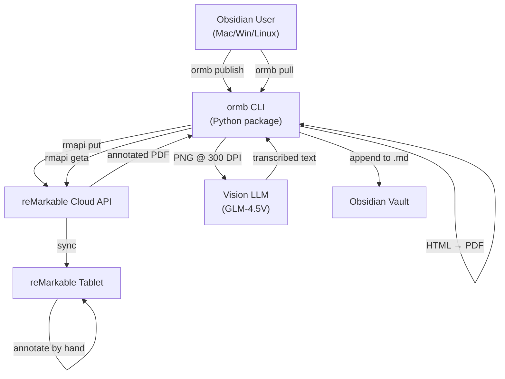
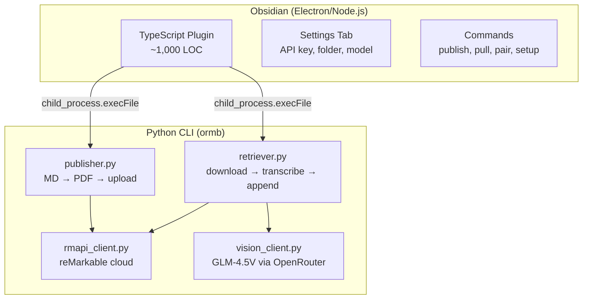

I use a reMarkable Paper Pro as my daily driver. I also use Obsidian for my knowledge base. The workflow I wanted was simple: publish a markdown document from Obsidian to the reMarkable, read it on e-ink, annotate by hand, then pull those handwritten annotations back into Obsidian as editable text.

No existing tool does this.

There are three Obsidian↔reMarkable plugins on the market. All of them go one direction: reMarkable → Obsidian. They sync your reMarkable notebooks into Obsidian as images or PDFs. None of them publish from Obsidian to the reMarkable. None of them transcribe handwriting back into markdown.

So I built the round-trip.

## The Origin Story

The code started life as a Hermes Agent skill — `veviki-remarkable-bridge` — tightly coupled to my personal AI assistant's environment. It worked. I'd been using it daily: publish a strategy document to the reMarkable, read it on e-ink, mark it up with a pen, pull the annotations back into the vault. The round-trip was proven.

But it was coupled to my infrastructure: hardcoded paths, a specific vision model, weasyprint for PDF generation (which requires GTK/Pango system libraries — a nightmare on Windows). Nobody else could use it.

The [first issue](https://github.com/vevmesteren/remarkable-roundtrip/issues/1) I opened when extracting it to open source was explicit:

> Build the `obsidian-rm-bridge` Python package (v0.1.0) from the architecture in `docs/ARCHITECTURE.md`. This is a refactor + decoupling of proven code, not a greenfield rewrite.

That distinction matters. This wasn't a from-scratch build — it was taking code that worked in production (my daily workflow) and making it portable.

## Architecture: Two Pipelines, One Round-Trip



### Publish Pipeline

```
Read .md → Extract mermaid blocks → Render mermaid → PNG (Playwright)
→ Replace mermaid blocks → MD → HTML (python-markdown)
→ Wrap in e-ink CSS (14pt serif, code wrap) → HTML → PDF (Playwright)
→ Upload via rmapi put
```

The publish pipeline takes a markdown file (or an entire folder) from your Obsidian vault, renders any mermaid diagrams to PNG via a headless Chromium browser, converts the markdown to HTML with e-ink-optimized CSS (14pt serif for readability, monospace code blocks that wrap instead of clipping), generates a PDF via Playwright's `page.pdf()`, and uploads it to the reMarkable cloud via `rmapi put`.

### Retrieve Pipeline

```
rmapi refresh → rmapi geta → PDF → PNG @ 300 DPI (pymupdf)
→ Each PNG → Vision LLM (GLM-4.5V) → Transcribe handwriting
→ Filter no-annotation pages → Format as markdown section
→ Append to source .md
```

The retrieve pipeline downloads the annotated PDF from the reMarkable cloud, renders each page to a 300 DPI PNG, sends each image to a vision LLM (GLM-4.5V via OpenRouter), which transcribes the handwritten annotations into structured markdown, filters out pages with no annotations, and appends the result to the original source file as a `## Annotations from reMarkable — YYYY-MM-DD` section.

This is the moat. Every existing Obsidian↔reMarkable plugin does marks-only or typed text. None transcribe freehand handwriting back into editable markdown. The vision LLM is what makes the round-trip actually round.

## The Key Architectural Decision: Playwright Over Everything

The original skill used two separate rendering tools: `weasyprint` for HTML→PDF and `mmdc` (mermaid CLI) for diagram rendering. Both had problems:

- **weasyprint** requires GTK, Pango, and HarfBuzz system libraries. On Windows, this means MSYS2 + GTK DLLs on PATH. The official docs themselves warn "read this chapter carefully."
- **mmdc** requires Node.js + Puppeteer + Chromium download. Another runtime, another dependency tree.

The [architecture document](https://github.com/vevmesteren/remarkable-roundtrip/blob/main/docs/ARCHITECTURE.md) records the decision:

> Replace both with Playwright. Playwright downloads its own Chromium binary via `pip install playwright && playwright install` — works identically on Mac, Windows, and Linux. Can render mermaid diagrams in-browser. Can produce PDFs via `page.pdf()`. Is actively maintained by Microsoft.

**Dependency reduction:** 3 system-level deps → 2 (Playwright + rmapi). The trade-off is ~280MB for the Chromium download. For a tool used by people who manage large document libraries on e-ink tablets, that's negligible. The install simplicity is worth every megabyte.

## The Stories: Five Phases, 50 Commits, 26 Issues

### Phase 1-3: Prove the Round-Trip (Nov 12)

The first three phases were built as a Hermes Agent skill in a single day. Publish worked. Retrieve worked. The vision model (GLM-4.5V) transcribed handwritten annotations accurately. This was the PoC — it proved the concept before any architecture was written.

### Phase 4: Open Source Extraction (Nov 12)

[Issue #1](https://github.com/vevmesteren/remarkable-roundtrip/issues/1) — Extract the skill into a standalone pip package. The design contracts were explicit:

- **DC-1:** Playwright is the sole rendering engine (no weasyprint, no mmdc)
- **DC-3:** Config via TOML + env vars, never hardcoded paths
- **DC-4:** Vision model is configurable, default GLM-4.5V
- **DC-8:** `rmapi put` never uses `--force` (creates duplicates, not replacements)

The result: `pip install remarkable-roundtrip` → `ormb setup` → `ormb pair` → working publish + pull. No Hermes coupling, no hardcoded paths, no GTK.

### Phase 5a: The Obsidian Plugin (Nov 13)

[Issue #6](https://github.com/vevmesteren/remarkable-roundtrip/issues/6) — Build a thin TypeScript Obsidian plugin that wraps the `ormb` CLI via `child_process.execFile`.

The architecture decision here was important: **the plugin is a thin wrapper, not a reimplementation.** All logic stays in the Python CLI. The plugin is ~200-300 lines of TypeScript that calls `ormb` as a subprocess, parses the JSON output, and displays progress in the Obsidian UI.

This drove a [prerequisite issue](https://github.com/vevmesteren/remarkable-roundtrip/issues/7) — the CLI needed a machine-readable JSON envelope output mode, `--vault` containment for path safety, a `doctor` command for diagnostics, and `set-key` via stdin (so the API key never appears in process arguments). These were [Phase 5a-0](https://github.com/vevmesteren/remarkable-roundtrip/issues/7), built before the plugin itself.

### Phase 5b: Pull Annotations + Marker Blocks (Nov 13)

[Issue #11](https://github.com/vevmesteren/remarkable-roundtrip/issues/11) — The pull command and marker blocks. When you publish a document, the plugin inserts a marker block into the markdown:

```markdown
<!-- RM-BRIDGE:published:doc_id:1234:page_count:5 -->
```

When you pull annotations, the plugin finds this marker, knows which reMarkable document corresponds to this note, and appends the transcribed annotations below it. No manual document ID tracking.

This phase was broken into five incremental changes ([#12-16](https://github.com/vevmesteren/remarkable-roundtrip/issues/12)), each one a focused, independently testable unit — from `strip_marker_blocks` in utils.py to the TypeScript pull command with confirmation modal.

### Phase 5c: The Cost Controller (Nov 14-15)

[Issue #25](https://github.com/vevmesteren/remarkable-roundtrip/issues/25) — The most important issue you've never heard of.

Every `ormb pull` was running the full vision pipeline: download PDF → render PNGs → send to vision LLM → transcribe. The problem: if you pull the same document twice and your annotations haven't changed, you pay for the vision API call twice.

This sounds like a performance optimization. It's not. It's a **cost controller**:

> This is a cost controller, not a performance optimization:
> 1. Wasted API spend — each pull sends page images to a vision LLM via OpenRouter. Paid API call.
> 2. Unnecessary data egress — the consent modal says "your annotations will be sent to OpenRouter." Re-sending unchanged images is data egress the user didn't intend to pay for.
> 3. User trust — if pulling the same document twice costs twice, the user will stop pulling. The bridge dies.

The fix: hash the downloaded PDF with SHA-256. Cache `{pdf_hash: transcription_result}` in a local JSON file. If the hash matches the last pull, skip the vision pipeline entirely and return the cached result. If the annotations change, the PDF hash changes, the cache misses, and the pipeline runs.

## Approach: Proven Code First, Then Decouple

The delivery philosophy was: **prove it works in production, then extract and generalize.** Not the other way around.

The original Hermes skill was built in a day (Phases 1-3). It was ugly — hardcoded paths, a single vision model, GTK dependencies. But it worked. I used it every day. I published strategy documents to the reMarkable, annotated them, and pulled the handwriting back into my knowledge base.

Only after the round-trip was proven did I write the architecture document, identify the coupling points, and start the extraction. This matters because:

1. **The architecture was informed by real usage, not hypothetical requirements.** I knew which corners were sharp because I'd cut myself on them.
2. **The design contracts (DC-1 through DC-10) were constraints discovered during use, not invented during planning.** The "never use `--force`" rule (DC-8) exists because I created duplicate documents and had to clean them up manually.
3. **The competitive moat was clear before the code was written.** I'd looked at every existing Obsidian↔reMarkable plugin. None did the round-trip. The vision LLM transcription was the differentiator, and it was already proven.

## The Obsidian Plugin: Thin Wrapper Architecture



The plugin is intentionally thin. All business logic lives in the Python CLI. The TypeScript layer handles:

- **Command palette entries** (publish active note, pull annotations, pair with reMarkable)
- **Settings management** (API key, reMarkable folder, vision model — stored in Obsidian settings, passed to the CLI via environment variables)
- **Progress display** (stderr lines from the CLI are parsed and shown in the Obsidian status bar)
- **Consent modal** (before pulling, the user explicitly consents to sending their annotations to OpenRouter)

The [topology detection](https://github.com/vevmesteren/remarkable-roundtrip/blob/main/plugin/src/topology.ts) is a nice touch: the plugin detects whether it's running on native Windows, WSL, macOS, or Linux, and adjusts how it calls the CLI accordingly. On WSL, it translates Windows vault paths to Linux paths. On macOS, it uses the system Python. On native Windows, it finds the WSL interpreter.

## The Numbers

| Metric | Value |
|--------|-------|
| Python CLI | ~2,500 lines across 12 modules |
| TypeScript plugin | ~1,000 lines across 13 modules |
| Tests | ~3,000 lines (Python + TypeScript) |
| Commits | 50 |
| Issues closed | 24 of 26 (2 open for v2) |
| Dependencies | Playwright + rmapi (2 system-level) |
| Vision cost per pull | ~$0.01-0.03 (cached pulls: $0.00) |
| Time from PoC to community store | 3 days |

## What's Next

Two issues are [deliberately left open for v2](https://github.com/vevmesteren/remarkable-roundtrip/issues):

- **[#19: Drawing recognition](https://github.com/vevmesteren/remarkable-roundtrip/issues/19)** — Hand-drawn diagrams → mermaid or image. Right now, the vision model transcribes handwriting as text. If you sketch an architecture diagram on the reMarkable, it comes back as a text description, not a mermaid diagram. Teaching the vision model to output mermaid syntax for hand-drawn diagrams is the natural next step.

- **[#23: Inline annotations](https://github.com/vevmesteren/remarkable-roundtrip/issues/23)** — Place annotations at their source position in the document. Right now, all annotations get appended as a single section at the bottom. The ideal is to insert each annotation next to the paragraph it annotates, preserving the spatial relationship between the original text and the handwritten note.

The code is at [github.com/vevmesteren/remarkable-roundtrip](https://github.com/vevmesteren/remarkable-roundtrip). MIT licensed. The Obsidian plugin is on the [community store](https://community.obsidian.md/plugins/rm-bridge). If you use Obsidian and a reMarkable, this gives you the workflow that every other tool promises but doesn't deliver: write, annotate by hand, and get your handwriting back as text.